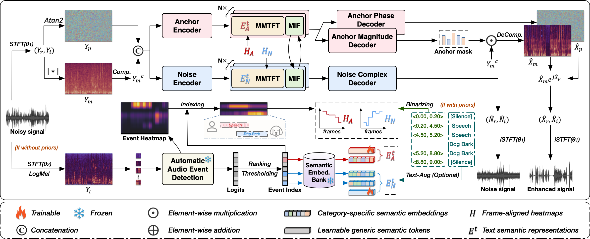

<div align="center">
  <h1>DANSE</h1>

  

  <p>
    <strong>Xincheng Yu, Jingxue Huang, Jian Zhang, Dongyue Guo, Jianwei Zhang, and Yi Lin*</strong>
  </p>

  <p>
    <a href="#"></a>
    <a href="https://xcyu-0903.github.io/DANSE-demo/"></a>
    <a href="https://github.com/XCYu-0903/DANSE"></a>
    <a href="https://huggingface.co/datasets/Ediethia/Libri-AudioEvent"></a>
  </p>

  <p><strong>DANSE</strong> is pronounced as <em>‘dance’</em> (/dɑːns/).</p>
</div>

## Architecture

<div align="center">
  
</div>


## Installation

Create an isolated environment, install a CUDA-enabled PyTorch build appropriate for your system, then install the project dependencies.

```bash
conda create -n DANSE python=3.9 -y
conda activate DANSE
# The pinned environment uses PyTorch 1.10.1 + CUDA 11.1. Any compatible
# PyTorch 1.x CUDA build is supported: https://pytorch.org/get-started/locally/
pip install -r requirements.txt
```

## Structure

-  `train.py`: Training entry. It supports training from scratch and resuming from split checkpoints.
-  `config.json`: Default DANSE configuration.
-  `models/`: DANSE backbone. 
-  `cp/danse_unimodal/g_best`: Released unimodal DANSE checkpoint.
-  `inference.py`: Speech enhancement and noise estimation entry point.

## Data Preparation

Download the DNS-Challenge synthesized training set and organize paired clean/noisy utterances as follows. The loader resamples audio to 16 kHz during training.

```text
data/DNS-Challenge/datasets
├── synthesized_data
│   ├── clean
│   └── noisy
└── validation
    ├── clean
    └── noisy
```

Create `validation` from paired utterances of speakers that do not appear in the training split. Keep the clean/noisy filenames paired, then create manifests containing `utterance_id|clean_audio_path`. `make_data.py` derives the DNS utterance ID from the final two underscore-separated filename fields and verifies every pair.

```bash
mkdir -p DNSChallenge2020

python make_data.py \
  --clean_dir data/DNS-Challenge/datasets/synthesized_data/clean \
  --noisy_dir data/DNS-Challenge/datasets/synthesized_data/noisy \
  --output_file DNSChallenge2020/train.txt

python make_data.py \
  --clean_dir data/DNS-Challenge/datasets/validation/clean \
  --noisy_dir data/DNS-Challenge/datasets/validation/noisy \
  --output_file DNSChallenge2020/validation.txt
```

## Training

Train the model on DNS-Challenge. At every `--validation_interval`, `train.py` computes the mean wideband PESQ on the independent-speaker validation split and saves `g_<pesq>_<step>` and `do_<pesq>_<step>`. The best pair is additionally written as `g_best` and `do_best`; resume defaults to the latest saved step and can use `--resume best` or `--resume <step>`.

```bash
CUDA_VISIBLE_DEVICES=0 python train.py \
  --input_train_clean_wavs_dir data/DNS-Challenge/datasets/synthesized_data/clean \
  --input_train_noisy_wavs_dir data/DNS-Challenge/datasets/synthesized_data/noisy \
  --input_valid_clean_wavs_dir data/DNS-Challenge/datasets/validation/clean \
  --input_valid_noisy_wavs_dir data/DNS-Challenge/datasets/validation/noisy \
  --input_training_file DNSChallenge2020/train.txt \
  --input_validation_file DNSChallenge2020/validation.txt \
  --checkpoint_path checkpoints \
  --experiment_name danse_unimodal
```

For multiple visible GPUs, use `torchrun --nproc_per_node=<num_gpus> train.py` with the same arguments.

## Inference

`inference.py` accepts the generator checkpoint and configuration JSON as separate paths. By default it uses the released files in `cp/danse_unimodal/`.

```bash
python inference.py --input_path example.wav
```

The input can be one audio file or a directory, which is searched recursively. All inputs are converted to mono and resampled to 16 kHz. Results are written to `output/speech` and `output/noise` by default.

```bash
# Process a directory and save only enhanced speech
python inference.py \
  --input_path /path/to/audio_directory \
  --checkpoint cp/danse_unimodal/g_best \
  --config cp/danse_unimodal/danse_m_config.json \
  --output_dir results \
  --signal speech
```

## Evaluation

`cal_metrics/cal_metrics.py` evaluates paired clean/enhanced directories by relative filename and reports PESQ-WB, PESQ-NB, CSIG, CBAK, COVL, SSNR, SI-SDR, STOI, DNSMOS, and NISQA. It expects the sibling `../cal_metrics/DNSMOS` and `../cal_metrics/NISQA-master` resources by default.

```bash
python cal_metrics/cal_metrics.py \
  --clean_dir /path/to/clean \
  --enhanced_dir /path/to/enhanced \
  --output_csv metrics.csv
```

Use `--metrics_root /path/to/cal_metrics` when those resources are located elsewhere.


## Acknowledgements

We referred to [MP-SENet](https://github.com/yxlu-0102/MP-SENet) and [CLAP](https://github.com/LAION-AI/CLAP) to implement this.

## Contact Us

If you are interested in leaving a message to our research team, feel free to email xinchengyu@alu.scu.edu.cn.

<p align="center">
  
  &nbsp;&nbsp;&nbsp;&nbsp;
  
</p>
